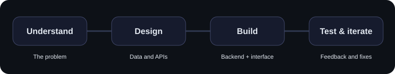

  
   
  
    
  
  

# Deshan Fernando

**Software Engineer | Backend & Full-Stack | Colombo, Sri Lanka**

Computer Science undergraduate at the University of Westminster / IIT, with software engineering internship experience at Sri Lanka Telecom. I build web applications with React, Node.js, TypeScript and SQL, with a focus on REST APIs, authentication and role-based access.

**Seeking Associate Software Engineer and Software Engineer opportunities.**

[Portfolio](https://deshanfdo.github.io/Portfolio/) · [Email](mailto:deshanfernando67@gmail.com) · [LinkedIn](https://linkedin.com/in/DeshanFdo31)

## 💼 Experience

**Software Engineer Intern — Sri Lanka Telecom** · June 2025 – May 2026

- Built and maintained Node.js backend services for assessment and evaluation workflows.
- Implemented role-based access and panel-level data isolation.
- Developed reusable React components and improved assessor workflows.
- Optimized database interactions and contributed through Agile sprints, debugging and code reviews.

## 🚀 Selected projects

| Project | Focus | Technologies |
| --- | --- | --- |
| [Enterprise Developer API Portal](https://github.com/deshanFdo/apiPortal) | Weather, stock and cryptocurrency dashboard with API gateway configuration and OpenAPI definitions | React, Node.js, Express, WSO2 API Manager, Docker |
| [LawLinkLK](https://github.com/deshanFdo/LawLink-LK) | Platform connecting clients with lawyers in Sri Lanka | React, Node.js, MongoDB, Socket.IO |
| [Clean Energy Website](https://github.com/deshanFdo/Clean-Energy-Website) | Team website about renewable energy | JavaScript, HTML, CSS |
| [Extreme Encode 2024](https://github.com/deshanFdo/Extreme-Encode-2024) | Selected competitive programming questions and solutions | Algorithms and problem solving |

## 🛠️ Technical focus

- **Backend:** Node.js, Express, TypeScript, REST APIs, JWT, RBAC
- **Frontend:** React, JavaScript, HTML, CSS, Tailwind CSS
- **Data:** MySQL, MongoDB
- **Tools:** Git, Docker, GitHub Actions, Postman, Jira

## 🎓 Education

**BSc (Hons) Computer Science** — University of Westminster / IIT, Sri Lanka
Expected graduation: May 2027

**Foundation Certificate in Higher Education IT** — IIT, Sri Lanka · Distinction

For opportunities or questions about my work, [email me](mailto:deshanfernando67@gmail.com).

## 📊 GitHub activity

  
   
  

Cards are provided by external services. Explore my repositories using the links above if a card is unavailable.

## 🐍 Contribution snake

  <picture>
    <source media="(prefers-color-scheme: dark)" srcset="https://raw.githubusercontent.com/deshanFdo/deshanFdo/output/github-snake-dark.svg" />
    <source media="(prefers-color-scheme: light)" srcset="https://raw.githubusercontent.com/deshanFdo/deshanFdo/output/github-snake.svg" />
    
  </picture>

Generated daily from my public contribution graph.

## ⚡ How I approach a project

  

## 🌱 Currently exploring

- Backend architecture and API integration patterns.
- Database query optimization and reliable authentication flows.
- Clear documentation, reproducible setup and useful automated tests.

  <a href="https://deshanfdo.github.io/Portfolio/">Explore my portfolio</a> ·
  <a href="mailto:deshanfernando67@gmail.com">Discuss an opportunity</a>
    
  

